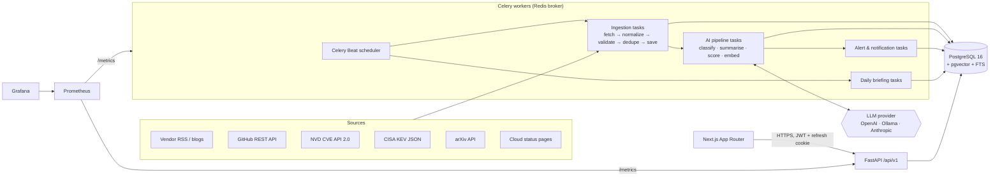
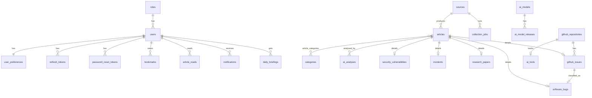

# AI Pulse — Architecture

AI Pulse collects, verifies, classifies, summarises and serves intelligence about AI, software
failures, security vulnerabilities and cloud/DevOps operations. This document is the reference for
every implementation phase. Status markers: ✅ implemented · 🚧 next phase · 📋 planned.

## 1. Guiding principles

1. **Provenance first.** Every record has its original `url`, `source`, `published_at` (from the
   source) and `collected_at` (ours), a `content_hash`, and a `verification_status`.
2. **Facts and AI output never mix.** Original content lives in `articles`; anything generated by an
   LLM lives in `ai_analyses` (versioned by prompt, with provider/model/tokens/cost) and is labelled
   "AI-generated" in the UI.
3. **No invented severity or status.** `severity` always has a `severity_basis` (e.g. *"NVD CVSS
   v3.1 base score 9.8"*). Our `importance_score` is a separate 0–100 ranking and is never shown as
   CVSS. An incident is "active" only if the provider's own status data says so *and* we verified it
   within the last 2 hours (`last_verified_at`).
4. **Idempotent everything.** Ingestion upserts on `(source_id, external_id)`; notifications dedupe
   on `(user_id, dedup_key)`; briefings are unique per `(user_id, briefing_date)`.
5. **Secrets only from the environment.** The app refuses to start in production with a weak
   `JWT_SECRET`. No keys ever reach the frontend.

## 2. System overview



### Layers (backend)

| Layer | Package | Responsibility |
|---|---|---|
| API | `app/api` | HTTP routing, request/response schemas, auth dependencies. No SQL. |
| Schemas | `app/schemas` | Pydantic contracts and validation. |
| Services | `app/services` | Business rules (auth flows, ranking, briefing composition). |
| Repositories | `app/repositories` | All SQLAlchemy queries. |
| Models | `app/models` | ORM entities, constraints, indexes. |
| Core | `app/core` | Config, security, logging, errors, metrics. |
| Connectors 🚧 | `app/ingestion/connectors` | One class per source implementing the connector contract. |
| AI 🚧 | `app/ai` | Provider abstraction, prompts, pipeline, embeddings, RAG. |
| Workers 🚧 | `app/workers` | Celery app, beat schedule, task wrappers. |

Dependencies point inwards only (API → services → repositories → models). Services receive the DB
session and collaborators (settings, email sender, LLM provider) via FastAPI dependency injection,
which is what the tests override.

## 3. Folder structure

```
ai-pulse/
├── docker-compose.yml          postgres(pgvector) · redis · migrate · api  (+ worker/beat/web/monitoring later)
├── .env.example
├── docs/ARCHITECTURE.md
├── backend/
│   ├── Dockerfile              multi-stage, non-root, healthcheck
│   ├── alembic/                migrations (0001 = full schema + seed roles/categories)
│   ├── app/
│   │   ├── main.py             app factory, middleware, routers
│   │   ├── cli.py              `python -m app.cli create-admin`
│   │   ├── core/               config · security · errors · logging · metrics
│   │   ├── db/                 declarative base, engine/session factory
│   │   ├── models/             enums · user · content · intel · ops
│   │   ├── schemas/            auth · article · source · dashboard · common
│   │   ├── repositories/       users · articles · sources
│   │   ├── services/           auth · articles · dashboard · email
│   │   ├── api/v1/             auth · news · dashboard · admin · health
│   │   ├── ingestion/   🚧     base connector, normalized item, connectors/*
│   │   ├── ai/          🚧     providers/*, pipeline, prompts, rag
│   │   └── workers/     🚧     celery_app, schedules, tasks
│   └── tests/                  integration tests against real Postgres + migrations
├── frontend/                   Next.js 16 App Router + Tailwind 4 + shadcn/ui
│   ├── Dockerfile              standalone output, non-root, BACKEND_URL build arg
│   └── src/
│       ├── app/(app)/          overview, news, models, tools, research, github, bugs, security,
│       │                       devops, briefing, bookmarks, analytics, settings, search
│       ├── app/(auth)/         login, register, forgot-password, reset-password
│       ├── components/ui/      shadcn-style primitives on Radix
│       ├── components/layout/  app shell, sidebar, global search, notifications, user menu, theme
│       ├── components/feed/    article card, badges, URL-synced filters, pagination, feed view
│       ├── components/{dashboard,charts,states}/
│       └── lib/                api client (silent refresh), auth context, query hooks, types, demo
└── monitoring/          📋     prometheus.yml, grafana dashboards, alert rules
```

## 4. Database schema

PostgreSQL 16 with `pgvector`. UUID primary keys (integers for small lookup tables). Enums are
stored as `VARCHAR + CHECK` for painless migrations. All timestamps are `timestamptz`.



| Table | Key columns / constraints |
|---|---|
| `roles` | `name` ∈ admin/analyst/user (seeded) |
| `users` | `email` unique (case-insensitive lookup), Argon2id `password_hash`, `role_id`, `is_active` |
| `user_preferences` | interests[], followed technologies/repos/providers[], `min_notification_severity`, `briefing_frequency`, `briefing_hour`, `timezone` |
| `refresh_tokens` | `token_hash` (SHA-256) unique, `family_id`, `expires_at`, `revoked_at`, `replaced_by_id` |
| `password_reset_tokens` | `token_hash` unique, `expires_at`, `used_at` (single use) |
| `sources` | `slug` unique, `source_type`, `connector`, `url`, `is_official`, `reliability` ∈ [0,1], `enabled`, `poll_interval_minutes ≥ 5`, `config` JSONB, `checkpoint` JSONB, health fields |
| `categories` | 15 seeded slugs (ai-models … docker) |
| **`articles`** | canonical item. **unique `(source_id, external_id)`**, `url`, `published_at`, `collected_at`, `source_updated_at`, `content_hash`, `verification_status`, `severity` + `severity_basis`, `importance_score` ∈ [0,100], `duplicate_of_id`, `raw` JSONB, `embedding vector(768)` (HNSW cosine), `search_vector tsvector` (generated, weighted A/B/C, GIN) |
| `ai_analyses` | `(article_id, kind, prompt_version)` unique, `provider`, `model`, `output` JSONB, tokens, `cost_usd`, `valid` |
| `ai_models` / `ai_model_releases` | `(provider, name)` unique; release version, date, context window, `source_url` |
| `ai_tools` | name unique, category, latest version, optional repository link |
| `research_papers` | `arxiv_id` unique, authors[], abstract, pdf url |
| `github_repositories` | `full_name` unique, stars/forks/issues, `star_history` snapshots, `stars_delta_7d` |
| `github_issues` | `(repository_id, number)` unique, state, labels[], PR flag, opened/updated/closed |
| `software_bugs` | kind (bug/regression/performance/compatibility/security), severity + `severity_basis`, affected/fixed versions, `fix_url` |
| `security_vulnerabilities` | `cve_id` unique, `cvss_score` ∈ [0,10] (official only), vector, CWE[], affected products, `known_exploited`, KEV dates, remediation (official only), references |
| `incidents` | `(provider, external_id)` unique, status, services[], regions[], started/resolved, `status_page_url`, `last_verified_at`, update log |
| `daily_briefings` | `(user_id, briefing_date)` unique, sections JSONB, cited article ids, provider/model |
| `bookmarks` | `(user_id, article_id)` unique, note |
| `article_reads` | PK `(user_id, article_id)` |
| `notifications` | `(user_id, dedup_key)` unique, kind, severity, `read_at` |
| `collection_jobs` | per run: status, counts (fetched/created/updated/skipped), attempt, errors JSONB |
| `audit_logs` | actor, action, target, details, IP |

**Embedding dimension** is fixed at 768: OpenAI `text-embedding-3-*` is called with
`dimensions=768`, Ollama's `nomic-embed-text` is natively 768. Changing it requires a migration.

## 5. API specification (`/api/v1`)

Interactive docs: `GET /docs` · schema: `GET /api/v1/openapi.json`. Errors always use
`{"error": {"code", "message", "details"}}`. Lists return `{items, total, page, page_size, pages}`.

| Module | Endpoints | Auth | Status |
|---|---|---|---|
| health | `GET /health/live`, `GET /health/ready` (DB + pgvector), `GET /metrics` | – | ✅ |
| auth | `POST register, login, refresh, logout, change-password, password-reset/request, password-reset/confirm` · `GET/PATCH me` | mixed | ✅ |
| news | `GET /news` (q, item_type[], category[], source[], severity[], min_importance, verification[], date_from, date_to, include_duplicates, sort=latest\|importance\|relevance, page, page_size) · `GET /news/{id}` · `PUT/DELETE /news/{id}/read` | optional | ✅ |
| dashboard | `GET /dashboard/summary` (KPIs, by type/category/severity, trending tags, 14-day activity, latest lists) | optional | ✅ |
| catalog | `GET /categories`, `GET /sources` (enabled sources, for filters) | – | ✅ |
| bookmarks | `GET /bookmarks`, `PUT/DELETE /bookmarks/{article_id}` (idempotent, optional note) | user | ✅ |
| notifications | `GET /notifications`, `GET /notifications/unread-count`, `POST /notifications/{id}/read`, `POST /notifications/read-all` | user | ✅ |
| preferences | `GET/PUT /preferences`, `GET /preferences/options` (validated interests, `owner/name` repos, IANA timezones) | user | ✅ |
| briefings | `GET /briefings`, `GET /briefings/latest`, `GET /briefings/{date}` (global + own personalised) | optional | ✅ read |
| admin | `GET/POST /admin/sources`, `PATCH/DELETE /admin/sources/{id}` (audited) | admin | ✅ |
| admin | users, roles, jobs, failed tasks, AI config, usage, audit log | admin | 🚧 P3/P8 |
| models · tools · research · github · bugs · security · incidents | typed lists + detail with module-specific filters | optional | 🚧 P3 |
| search | `GET /search` keyword · semantic · hybrid; `POST /search/ask` RAG with citations | optional | 🚧 P5 |
| briefings | `POST /briefings/generate` and scheduled generation | user | 🚧 P7 |

**Auth model.** Access token: HS256 JWT, 15 min, sent as `Authorization: Bearer`, kept in memory by
the frontend. Refresh token: opaque 384-bit random value, stored only as SHA-256, delivered as an
`httpOnly; Secure; SameSite=Strict; Path=/api/v1/auth` cookie, rotated on every use. Replaying an
already-rotated token revokes the whole token family (theft detection). Password change/reset
revokes every session. Login uses a dummy hash for unknown emails to avoid user enumeration by
timing; reset requests return the same response whether or not the account exists.

## 6. Ingestion workflow 🚧 (Phase 4)

```
Celery Beat ──(every N min per source)──▶ ingest_source(source_id)
  1. lock source (Redis SET NX) → skip if already running
  2. create collection_jobs row (running)
  3. connector.fetch(checkpoint)   rate-limited, retries w/ exponential backoff + jitter, honours Retry-After
  4. connector.normalize(raw)      → NormalizedItem (url, external_id, title, published_at, …)
  5. connector.validate(item)      drop items without URL/title; never fill missing fields
  6. deduplicate                   exact: (source, external_id) + content_hash; near: canonical URL,
                                   title similarity, later embedding cosine ≥ 0.92 → duplicate_of_id
  7. save                          INSERT … ON CONFLICT (source_id, external_id) DO UPDATE
  8. update checkpoint, source health, job counts; enqueue AI analysis for new/changed items
  on failure: job=failed, source.consecutive_failures++, error stored; retried by policy
```

Planned connectors (only official/authoritative endpoints, respecting terms and rate limits):
vendor RSS/Atom feeds (OpenAI, Google DeepMind, Hugging Face, Kubernetes, Docker, AWS What's New…),
arXiv API (≥3 s between requests per arXiv policy), GitHub REST (search-based "trending" proxy —
GitHub has **no** trending API; we rank by stars gained between our own snapshots), NVD CVE API 2.0
(`lastModStartDate` windows, API key raises limit), CISA KEV JSON, cloud status pages / feeds.
Sources whose official channel has no machine-readable feed are not scraped silently; they are
documented as unsupported until a compliant integration exists.

## 7. AI processing workflow 🚧 (Phase 5)

`LLMProvider` protocol (`complete_json(schema, messages)`, `embed(texts)`) with OpenAI, Ollama and
Anthropic implementations selected by `LLM_PROVIDER`; model names come from env only.

Pipeline per item: clean → detect language → classify (multi-label, 15 categories) → extract
keywords/entities → near-duplicate check → importance score → summary & impact analysis → embed.
Outputs are validated against Pydantic schemas; invalid JSON is retried once then stored with
`valid=false`. Every claim in generated text must reference source fields; vulnerability
remediation is only produced when present in NVD/KEV/vendor data.

**Importance score (0–100, explainable)** = weighted sum of source reliability, severity (from
official basis), recency decay, KEV/exploitation flag, technical impact, and user-interest match;
the per-factor breakdown is stored in `ai_analyses(kind=importance)`.

**Search/RAG:** keyword (FTS `ts_rank_cd`), semantic (pgvector cosine), hybrid (reciprocal rank
fusion) with metadata filters. RAG answers cite article IDs/URLs and reply "insufficient
information" when retrieval confidence is low.

## 8. Security architecture

| Concern | Control | Status |
|---|---|---|
| Passwords | Argon2id, rehash on login when params change, strength policy (≥12 chars, 3 classes) | ✅ |
| Tokens | short JWT + rotating hashed refresh tokens, reuse detection, revocation on password change | ✅ |
| Cookies | httpOnly, Secure (configurable for local http), SameSite=Strict, path-scoped | ✅ |
| AuthZ | role-based dependencies (`require_roles`) on admin routes | ✅ |
| Secrets | env only; production refuses dev JWT secret / exposed reset tokens | ✅ |
| Input | Pydantic validation on every body/query, bounded page sizes, URL validation | ✅ |
| Headers/CORS | nosniff, frame deny, referrer policy; explicit CORS allow-list | ✅ |
| Audit | admin mutations recorded in `audit_logs` | ✅ (sources) |
| Rate limiting | Redis-backed per-IP/per-user limits on auth & search | 📋 P8 |
| Supply chain | pinned deps, CI lint/tests, container + dependency scanning | ✅ partial / 📋 P8 |
| Containers | non-root user, healthchecks, internal network, DB bound to 127.0.0.1 | ✅ |

## 9. Roadmap

| Phase | Scope | Status |
|---|---|---|
| 1 | Architecture, full schema + migration, auth, news/dashboard/admin-sources API, tests, Docker, CI | ✅ |
| 2 | Next.js UI: layout, sidebar, dashboard, feed, filters, all pages, auth flows (+ bookmarks/notifications/preferences/briefings read API) | ✅ |
| 3 | Remaining typed API modules (models, tools, research, github, bugs, security, incidents, admin users) | 📋 |
| 4 | Ingestion engine: connector framework, Celery/Beat, real connectors, job tracking, ingestion dashboard | 📋 |
| 5 | AI engine: providers, pipeline, scoring, embeddings, hybrid search, RAG with citations | 📋 |
| 6 | Bugs & Failures radar + alerting thresholds | 📋 |
| 7 | Personalised briefings + notifications + scheduling | 📋 |
| 8 | Production: worker/beat/web images, Prometheus/Grafana, rate limiting, scanning, docs | 📋 |
| 9 | Full audit & hardening | 📋 |

## 10. Frontend architecture

- **Same-origin API.** The browser calls `/api/v1/*` on the Next.js origin; Next rewrites it to
  FastAPI (`BACKEND_URL`, resolved at build time). The refresh cookie therefore stays first-party
  (`SameSite=Strict`) and no backend address or secret reaches the client bundle.
- **Auth.** Access token kept in memory only. On load, `POST /auth/refresh` restores the session from
  the httpOnly cookie; any 401 triggers one de-duplicated silent refresh and retry.
- **Data.** TanStack Query per resource; bookmark/read toggles update every cached copy optimistically
  and roll back on error. Feed filters live in the URL (shareable, back/forward-safe) and are parsed
  through a whitelist (`lib/feed-params.ts`).
- **Trust cues.** Source + verification badge, published vs collected timestamps, severity always shown
  with its text label and documented basis, importance score labelled "not CVSS", AI text in a
  separately styled block labelled *AI-generated* with provider/model. Only `http(s)` URLs are rendered
  as links.
- **Charts.** Single-series charts use one validated blue; severity uses reserved status colours with
  text labels; violet is decorative only (blue/violet failed the colour-vision separation check, so they
  never encode two series). Each chart has a table view.
- **Demo mode** (`NEXT_PUBLIC_DEMO_MODE=true`) swaps the API client for in-memory fictional fixtures,
  all prefixed `[DEMO]` with `example.com` links and a permanent banner. Off by default.
