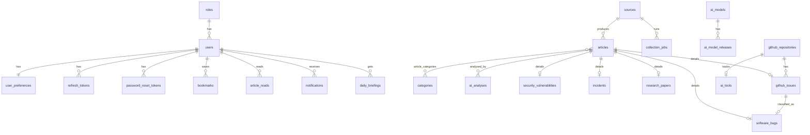

# AI Pulse — Architecture

AI Pulse collects, verifies, classifies, summarises and serves intelligence about AI, software
failures, security vulnerabilities and cloud/DevOps operations. This document is the reference for
every implementation phase. Status markers: ✅ implemented · 🚧 next phase · 📋 planned.

## 1. Guiding principles

1. **Provenance first.** Every record has its original `url`, `source`, `published_at` (from the
   source) and `collected_at` (ours), a `content_hash`, and a `verification_status`.
2. **Facts and AI output never mix.** Original content lives in `articles`; anything generated by an
   LLM lives in `ai_analyses` (versioned by prompt, with provider/model/tokens/cost) and is labelled
   "AI-generated" in the UI.
3. **No invented severity or status.** `severity` always has a `severity_basis` (e.g. *"NVD CVSS
   v3.1 base score 9.8"*). Our `importance_score` is a separate 0–100 ranking and is never shown as
   CVSS. An incident is "active" only if the provider's own status data says so *and* we verified it
   within the last 2 hours (`last_verified_at`).
4. **Idempotent everything.** Ingestion upserts on `(source_id, external_id)`; notifications dedupe
   on `(user_id, dedup_key)`; briefings are unique per `(user_id, briefing_date)`.
5. **Secrets never in code, images or the repository.** They come from Docker secret files
   (`/run/secrets/*`) or environment variables. In production the app refuses to start with a weak
   `JWT_SECRET`, insecure cookies or wildcard CORS. No key ever reaches the frontend.

## 2. System overview

```mermaid
flowchart LR
  U((Users)) -->|HTTPS| EDGE[Caddy edge<br/>TLS · HSTS · real client IP]
  EDGE -->|/api/*| API
  EDGE -->|pages| WEB[Next.js web<br/>standalone, non-root]
  WEB -.->|same-origin rewrite<br/>(no edge, local)| API[FastAPI /api/v1<br/>rate limits · RBAC · audit]
  subgraph Sources
    RSS[Vendor blogs / RSS] & GH[GitHub API] & NVD[NVD · CISA KEV · GHSA] & ARX[arXiv · HF] & STAT[Status pages]
  end
  subgraph Workers["Celery (Redis broker)"]
    BEAT[Beat<br/>heartbeat] --> ING[Ingestion<br/>fetch → normalize → validate → dedupe → save]
    ING --> AIQ[AI pipeline]
    BEAT --> ALERT[Alert engine] & BRIEF[Briefings]
  end
  Sources --> ING
  API & ING & AIQ & ALERT & BRIEF --> PG[(PostgreSQL 16<br/>pgvector · FTS · pg_trgm)]
  API & Workers --> R[(Redis<br/>queue · rate limits · telemetry)]
  AIQ & API <--> LLM{{LLM provider<br/>OpenAI · Anthropic · Ollama}}
  PROM[Prometheus + alert rules] -->|/metrics (token)| API
  PROM --> PGX[postgres-exporter] & RX[redis-exporter]
  PROM --> AM[Alertmanager → webhook]
  GRAF[Grafana dashboards] --> PROM
  BK[backup service<br/>pg_dump + sha256] --> PG
```

Networks (docker-compose): `data` (PostgreSQL, Redis: **internal**, no internet, not published),
`egress` (workers/API → sources and LLM providers), `frontend` (edge → web/API, fixed subnet; the API
trusts `X-Forwarded-For` only from the edge's fixed IP), `monitoring` (Prometheus ↔ Grafana/Alertmanager).

### Layers (backend)

| Layer | Package | Responsibility |
|---|---|---|
| API | `app/api` | HTTP routing, request/response schemas, auth dependencies. No SQL. |
| Schemas | `app/schemas` | Pydantic contracts and validation. |
| Services | `app/services` | Business rules (auth flows, ranking, briefing composition). |
| Repositories | `app/repositories` | All SQLAlchemy queries. |
| Models | `app/models` | ORM entities, constraints, indexes. |
| Core | `app/core` | Config, security, logging, errors, metrics. |
| Ingestion ✅ | `app/ingestion` | Connector contract, normalized format, HTTP client (retries, rate limits), writer, runner, scheduling, catalog. |
| AI ✅ | `app/ai` | Providers, text/NLP, claims checks, scoring, pipeline, search (BM25/semantic/RRF), RAG, briefings. |
| Workers ✅ | `app/workers` | Celery app, Beat schedule (heartbeat scheduler), tasks, task telemetry. |
| Alerts ✅ | `app/alerts` | Alert rules and idempotent in-app notification delivery. |

Dependencies point inwards only (API → services → repositories → models). Services receive the DB
session and collaborators (settings, email sender, LLM provider) via FastAPI dependency injection,
which is what the tests override.

## 3. Folder structure

```
ai-pulse/
├── docker-compose.yml          base stack (production defaults, secrets, networks, limits, profiles)
├── docker-compose.dev.yml      development override (hot reload, source mounts, host ports)
├── docker-compose.prod.yml     production override (registry images, replicas, restart: always)
├── .env.example                non-secret Compose configuration (secrets live in ./secrets)
├── SECURITY.md · CONTRIBUTING.md
├── docs/                       ARCHITECTURE · API · DATABASE · DEVELOPMENT · DEPLOYMENT ·
│                               INGESTION · AI · RADAR · NOTIFICATIONS
├── .github/                    workflows: ci (lint, types, tests, audits, images, Trivy, e2e),
│                               deploy (GHCR + provenance, SSH roll-out, rollback), codeql; dependabot
├── scripts/                    generate-secrets · smoke-test · backup · restore · deploy ·
│                               build-dashboards (Grafana dashboards as code)
├── infra/
│   ├── postgres/               image (pgvector, OS updates, tuned postgresql.conf, init: extensions,
│   │                           least-privilege app role, metrics role)
│   ├── redis/                  image (password from secret, AOF, noeviction, dangerous commands off)
│   ├── prometheus/             scrape config, 17 alert rules + promtool unit tests
│   ├── alertmanager/           webhook routing (URL from a secret)
│   ├── grafana/                provisioning + 2 dashboards (service health; pipeline, ingestion & AI)
│   ├── caddy/                  edge: automatic HTTPS, security headers, /api → api, rest → web
│   └── backup/                 scheduled pg_dump loop + health check
├── backend/
│   ├── Dockerfile              one file, targets api · worker · beat · migrate (non-root, no pip)
│   ├── docker/healthcheck.py   api / worker / beat health checks
│   ├── alembic/                migrations 0001 … 0006 (round-trip tested in CI)
│   ├── app/
│   │   ├── main.py             app factory, middleware (metrics, global rate limit, security headers)
│   │   ├── core/               config (env + secret files) · security · errors · logging · metrics ·
│   │   │                       ratelimit
│   │   ├── models/ schemas/ repositories/ services/ api/v1/   (layers, see above)
│   │   ├── ingestion/          connectors/* (15), http, ratelimit, writer, runner, scheduling
│   │   ├── ai/                 providers, pipeline, scoring, search, rag, briefing
│   │   ├── alerts/             alert engine
│   │   └── workers/            celery_app, tasks, telemetry (task durations, Beat heartbeat)
│   └── tests/                  real PostgreSQL + migrations (199 tests; frontend: 27 Vitest tests)
└── frontend/                   Next.js 16 App Router + Tailwind 4 + shadcn/ui
    ├── Dockerfile              standalone output, non-root, no npm in the runtime image
    └── src/app/(app)/admin/    overview (health, usage), users & roles, sources, connector health,
                                jobs & failures, AI providers & usage, audit log
```

## 4. Database schema

PostgreSQL 16 with `pgvector`. UUID primary keys (integers for small lookup tables). Enums are
stored as `VARCHAR + CHECK` for painless migrations. All timestamps are `timestamptz`.



| Table | Key columns / constraints |
|---|---|
| `roles` | `name` ∈ admin/analyst/user (seeded) |
| `users` | `email` unique (case-insensitive lookup), Argon2id `password_hash`, `role_id`, `is_active` |
| `user_preferences` | interests[], followed technologies/repos/providers[], `min_notification_severity`, `briefing_frequency`, `briefing_hour`, `timezone` |
| `refresh_tokens` | `token_hash` (SHA-256) unique, `family_id`, `expires_at`, `revoked_at`, `replaced_by_id` |
| `password_reset_tokens` | `token_hash` unique, `expires_at`, `used_at` (single use) |
| `sources` | `slug` unique, `source_type`, `connector`, `url`, `is_official`, `reliability` ∈ [0,1], `enabled`, `poll_interval_minutes ≥ 5`, `config` JSONB, `checkpoint` JSONB, health fields |
| `categories` | 15 seeded slugs (ai-models … docker) |
| **`articles`** | canonical item. **unique `(source_id, external_id)`**, `url`, `published_at`, `collected_at`, `source_updated_at`, `content_hash`, `verification_status`, `severity` + `severity_basis`, `importance_score` ∈ [0,100], `duplicate_of_id`, `raw` JSONB, `embedding vector(768)` (HNSW cosine), `search_vector tsvector` (generated, weighted A/B/C, GIN) |
| `ai_analyses` | `(article_id, kind, prompt_version)` unique, `provider`, `model`, `output` JSONB, tokens, `cost_usd`, `valid` |
| `ai_models` / `ai_model_releases` | `(provider, name)` unique; release version, date, context window, `source_url` |
| `ai_tools` | name unique, category, latest version, optional repository link |
| `research_papers` | `arxiv_id` unique, authors[], abstract, pdf url |
| `github_repositories` | `full_name` unique, stars/forks/issues, `star_history` snapshots, `stars_delta_7d` |
| `github_issues` | `(repository_id, number)` unique, state, labels[], PR flag, opened/updated/closed |
| `software_bugs` | kind (bug/regression/performance/compatibility/security), severity + `severity_basis`, affected/fixed versions, `fix_url` |
| `security_vulnerabilities` | `cve_id` unique, `cvss_score` ∈ [0,10] (official only), vector, CWE[], affected products, `known_exploited`, KEV dates, remediation (official only), references |
| `incidents` | `(provider, external_id)` unique, status, services[], regions[], started/resolved, `status_page_url`, `last_verified_at`, update log |
| `daily_briefings` | `(user_id, briefing_date)` unique, sections JSONB, cited article ids, provider/model |
| `bookmarks` | `(user_id, article_id)` unique, note |
| `article_reads` | PK `(user_id, article_id)` |
| `notifications` | `(user_id, dedup_key)` unique, kind, severity, `read_at` |
| `collection_jobs` | per run: status, counts (fetched/created/updated/skipped), attempt, errors JSONB |
| `audit_logs` | actor, action, target, details, IP |

**Embedding dimension** is fixed at 768: OpenAI `text-embedding-3-*` is called with
`dimensions=768`, Ollama's `nomic-embed-text` is natively 768. Changing it requires a migration.

## 5. API specification (`/api/v1`)

Interactive docs: `GET /docs` · schema: `GET /api/v1/openapi.json`. Errors always use
`{"error": {"code", "message", "details"}}`. Lists return `{items, total, page, page_size, pages}`.

**List conventions (typed modules).** Query parameters are bound to strict Pydantic models — unknown
parameters are rejected (422). `page` ≥ 1, `page_size` 1–100. `sort=field` ascending or `sort=-field`
descending against a per-endpoint whitelist; an invalid value returns 400 with the allowed list.
Descending sorts put NULLs last (e.g. a CVE with no published CVSS never outranks a scored one).
Severity sorts by rank (critical → info), not alphabetically. Text filters are literal substring
matches (`%`/`_` are escaped).

| Module | Endpoints | Auth | Status |
|---|---|---|---|
| health | `GET /health/live`, `GET /health/ready` (DB + pgvector), `GET /metrics` | – | ✅ |
| auth | `POST register, login, refresh, logout, change-password, password-reset/request, password-reset/confirm` · `GET/PATCH me` | mixed | ✅ |
| news | `GET /news` (q, item_type[], category[], source[], severity[], min_importance, verification[], date_from, date_to, include_duplicates, sort=latest\|importance\|relevance, page, page_size) · `GET /news/{id}` · `PUT/DELETE /news/{id}/read` | optional | ✅ |
| dashboard | `GET /dashboard/summary` (KPIs, by type/category/severity, trending tags, 14-day activity, latest lists) | optional | ✅ |
| catalog | `GET /categories`, `GET /sources` (enabled sources, for filters) | – | ✅ |
| bookmarks | `GET /bookmarks`, `PUT/DELETE /bookmarks/{article_id}` (idempotent, optional note) | user | ✅ |
| notifications | `GET /notifications` (kind[], severity[], unread_only), `GET /notifications/unread-count` (+ by_kind), `POST /notifications/{id}/read\|unread`, `DELETE /notifications/{id}` (soft, dedup kept), `POST /notifications/read-all?kind=` — see [NOTIFICATIONS.md](NOTIFICATIONS.md) | user | ✅ |
| preferences | `GET/PUT /preferences` (+ `briefing_weekday`, notification rules in `alert_settings`), `POST /preferences/follow\|unfollow`, `GET /preferences/options` (validated interests, `owner/name` repos, IANA timezones) | user | ✅ |
| briefings | `GET /briefings`, `GET /briefings/latest`, `GET /briefings/{date}` (global + own personalised) | optional | ✅ read |
| admin | `GET/POST /admin/sources`, `PATCH/DELETE /admin/sources/{id}` (audited) | admin | ✅ |
| admin | `GET /admin/users`, `GET/PATCH /admin/users/{id}` (role, active; audited; self-lockout and last-admin protection; deactivation revokes sessions), `GET /admin/roles`, `GET /admin/audit-logs` | admin | ✅ |
| admin | `GET /admin/jobs` (ingestion history, duration, errors) | admin, analyst | ✅ |
| admin | `GET /admin/system/health`, `GET /admin/usage?days=`, `GET /admin/ai/config` (no secrets), `POST /admin/jobs/retry-failed?hours=` (audited) | staff | ✅ |
| models | `GET /models` (q, provider, open_weights, modality; latest release + count), `GET /models/releases` (provider, model_id, date range), `GET /models/{id}` | optional | ✅ |
| tools | `GET /tools` (q, category, license), `GET /tools/{id}` | optional | ✅ |
| research | `GET /research` (q, primary_category, author, date range), `GET /research/{uuid or arXiv id}` | optional | ✅ |
| github | `GET /github/repositories` (q, language, topic, min_stars, tracked; sort `-stars_delta_7d`), `GET /github/repositories/{id}`, `GET /github/repositories/by-name/{owner}/{name}`, `GET /github/issues` (repository, state, label, is_pull_request, date range) | optional | ✅ |
| bugs | `GET /bugs` (q, project, kind, severity, status, has_fix; title/labels resolved from the linked issue or article), `GET /bugs/{id}` | optional | ✅ |
| security | `GET /security/vulnerabilities` (q, severity, min_cvss, known_exploited, patch_available, product, cwe, date range), `GET /security/vulnerabilities/{CVE-ID}` (adds remediation + references), `GET /security/stats` | optional | ✅ |
| incidents | `GET /incidents` (q, provider, status, active_only, date range; computed `is_active` and `status_is_stale`), `GET /incidents/{id}` (update log) | optional | ✅ |
| search | `GET /search` keyword mode: FTS ranking + `[[highlighted]]` plain-text snippets, type/category/severity/date filters | optional | ✅ |
| search | `mode=semantic|hybrid`, `GET /search/capabilities`, `POST /search/ask` (RAG with citations) | optional | ✅ |
| news | `GET /news/{id}/analysis` (AI analysis + explainable importance, personalised when signed in) | optional | ✅ |
| admin | `GET /admin/ai/status`, `POST /admin/ai/run` | staff | ✅ |
| briefings | `POST /briefings/generate` + scheduled per-user generation (timezone, frequency) | user | ✅ |
| radar | `GET /radar/summary?days=` (KPIs, severity chart, most affected, incident history, weekly stats); `/bugs` adds `resolution`, `reported_within_days`; `/incidents` adds `state=current\|historical\|unverified`, `category` — see [RADAR.md](RADAR.md) | optional | ✅ |
| admin | `POST /admin/alerts/run` (evaluate alert rules now, audited) | staff | ✅ |

**Auth model.** Access token: HS256 JWT, 15 min, sent as `Authorization: Bearer`, kept in memory by
the frontend. Refresh token: opaque 384-bit random value, stored only as SHA-256, delivered as an
`httpOnly; Secure; SameSite=Strict; Path=/api/v1/auth` cookie, rotated on every use. Replaying an
already-rotated token revokes the whole token family (theft detection). Password change/reset
revokes every session. Login uses a dummy hash for unknown emails to avoid user enumeration by
timing; reset requests return the same response whether or not the account exists.

## 6. Ingestion workflow ✅ (Phase 4)

See **[INGESTION.md](INGESTION.md)** for the full design, the source catalog and operations. In short:
Celery Beat ticks every minute → `dispatch_due_sources` reads the schedule from Postgres (interval ×
2^failures backoff) → `ingest_source` takes a per-source advisory lock and runs
`fetch → normalize → validate → deduplicate → save → reconcile`, committing items, typed rows,
checkpoint and job/health stats in a single transaction. 14 connectors cover 27 seeded official
sources (RSS/Atom, arXiv, Hugging Face, GitHub, NVD, CISA KEV, Kubernetes CVE feed, Google Cloud /
AWS / Azure status, Statuspage). Per-host rate limits are shared across workers through Redis.

## 7. AI processing workflow ✅ (Phase 5)

See **[AI.md](AI.md)**. Provider abstraction (OpenAI, Anthropic, Ollama; env-configured), a 10-step pipeline
(steps 1–7 deterministic for every item, 8–10 LLM for the most important items, token-budgeted), grounding
checks that remove unsupported claims and invented remediation, an explainable importance score (not CVSS),
keyword / semantic / hybrid (BM25 + RRF) search, cited RAG answers with an "insufficient information" gate,
and personalised daily briefings. Usage and cost per call in `ai_usage`.

## 8. Security architecture

Full threat model, controls and procedures: **[SECURITY.md](../SECURITY.md)**.

| Concern | Control | Status |
|---|---|---|
| Passwords | Argon2id, rehash on login when params change, strength policy (≥12 chars, 3 classes) | ✅ |
| Tokens | short JWT + rotating hashed refresh tokens, reuse detection, revocation on password change | ✅ |
| Cookies | httpOnly, Secure (enforced in production), SameSite=Strict, path-scoped | ✅ |
| AuthZ | role-based dependencies (`require_roles`): admin, analyst (staff), user | ✅ |
| Secrets | Docker secret files (`/run/secrets`), never in images/env files/git; production refuses weak settings | ✅ |
| Input | Pydantic validation on every body/query (unknown params rejected), bounded page sizes, URL validation | ✅ |
| Rate limiting | Redis fixed windows: global per IP, auth per IP, search and AI per user; 429 + `Retry-After` | ✅ |
| Client IP | `X-Forwarded-For` trusted only from the edge's fixed IP (no spoofing) | ✅ |
| Headers/CORS | nosniff, frame deny, referrer/permissions policy, `no-store` on API, HSTS (prod/edge); explicit CORS allow-list | ✅ |
| Audit | admin mutations (users, sources, jobs, AI/alert runs) recorded with actor and IP | ✅ |
| Supply chain | pinned deps, pip-audit + npm audit, Trivy image gate, CodeQL, Dependabot, SBOM + provenance | ✅ |
| Containers | non-root, read-only root FS, `cap_drop: ALL`, no-new-privileges, internal data network, limits | ✅ |
| Database | application role is not superuser; separate read-only metrics role; scram-sha-256; checksums | ✅ |
| Backups | scheduled + pre-deployment `pg_dump`, checksums, verified restore into a staging database | ✅ |

## 9. Roadmap

| Phase | Scope | Status |
|---|---|---|
| 1 | Architecture, full schema + migration, auth, news/dashboard/admin-sources API, tests, Docker, CI | ✅ |
| 2 | Next.js UI: layout, sidebar, dashboard, feed, filters, all pages, auth flows (+ bookmarks/notifications/preferences/briefings read API) | ✅ |
| 3 | Typed API modules (models, tools, research, github, bugs, security, incidents), keyword search with snippets, admin users/roles/jobs/audit, filter indexes (migration 0002), frontend panels | ✅ |
| 4 | Ingestion engine: 14 connectors / 27 official sources, Celery + Beat, retries, rate limits, checkpoints, dedup, failed-job tracking, source health, admin ingestion dashboard | ✅ |
| 5 | AI engine: providers, 10-step pipeline with grounding checks, explainable scoring, embeddings, hybrid search, RAG with citations, personalised briefings | ✅ |
| 6 | Bugs & Failures radar (bugs/incidents/vulnerabilities, state & categories, GitHub advisories) + configurable alerts, migration 0005 | ✅ |
| 7 | Personalised briefings (10 sections, computed changes), per-user scheduling with timezone/weekday, retries & idempotency, notification preferences & center, follow API, migration 0006 | ✅ |
| 8 | Production: images (api/worker/beat/migrate/web/postgres/redis), compose dev/prod, CI/CD, Trivy & audits, Prometheus/Grafana/alerts, rate limiting, admin console, backups, docs | ✅ |
| 9 | Full audit & hardening | 📋 |

## 10. Frontend architecture

- **Same-origin API.** The browser calls `/api/v1/*` on the Next.js origin; Next rewrites it to
  FastAPI (`BACKEND_URL`, resolved at build time). The refresh cookie therefore stays first-party
  (`SameSite=Strict`) and no backend address or secret reaches the client bundle.
- **Auth.** Access token kept in memory only. On load, `POST /auth/refresh` restores the session from
  the httpOnly cookie; any 401 triggers one de-duplicated silent refresh and retry.
- **Data.** TanStack Query per resource; bookmark/read toggles update every cached copy optimistically
  and roll back on error. Feed filters live in the URL (shareable, back/forward-safe) and are parsed
  through a whitelist (`lib/feed-params.ts`).
- **Trust cues.** Source + verification badge, published vs collected timestamps, severity always shown
  with its text label and documented basis, importance score labelled "not CVSS", AI text in a
  separately styled block labelled *AI-generated* with provider/model. Only `http(s)` URLs are rendered
  as links.
- **Charts.** Single-series charts use one validated blue; severity uses reserved status colours with
  text labels; violet is decorative only (blue/violet failed the colour-vision separation check, so they
  never encode two series). Each chart has a table view.
- **Demo mode** (`NEXT_PUBLIC_DEMO_MODE=true`) swaps the API client for in-memory fictional fixtures,
  all prefixed `[DEMO]` with `example.com` links and a permanent banner. Off by default.

## 11. Deployment & operations

See **[DEPLOYMENT.md](DEPLOYMENT.md)** (first deployment, TLS, secrets, monitoring, alerts, backups,
upgrades and rollback), **[DEVELOPMENT.md](DEVELOPMENT.md)**, **[DATABASE.md](DATABASE.md)** and
**[API.md](API.md)**.

| Concern | Implementation |
|---|---|
| Process model | 1 uvicorn process per API container (scale with replicas); Celery worker (prefork 4, `max-tasks-per-child`); exactly one Beat |
| Health | API `/health/live`, `/health/ready` (DB + pgvector); worker = Celery ping; Beat = Redis heartbeat; Postgres/Redis native checks; backup = age of the newest dump |
| Metrics | HTTP latency/requests (route templates), DB pool + server connections, queue length, ingestion jobs, source availability, AI calls/errors/tokens/cost, Celery task durations/failures/retries, Beat heartbeat, rate-limit rejections |
| Logs | JSON (structlog) on stdout, rotated by the Docker log driver |
| Alerts | 17 Prometheus rules (availability, latency, errors, DB connections, backlog, Beat, dispatch, failing sources/jobs/tasks, slow jobs, AI errors/spend/backlog, Redis memory), unit-tested with promtool |
| Releases | tag `v*` → CI gates → images to GHCR with SBOM + provenance → environment approval → SSH roll-out with pre-deploy backup, migrations, smoke test, automatic rollback |

